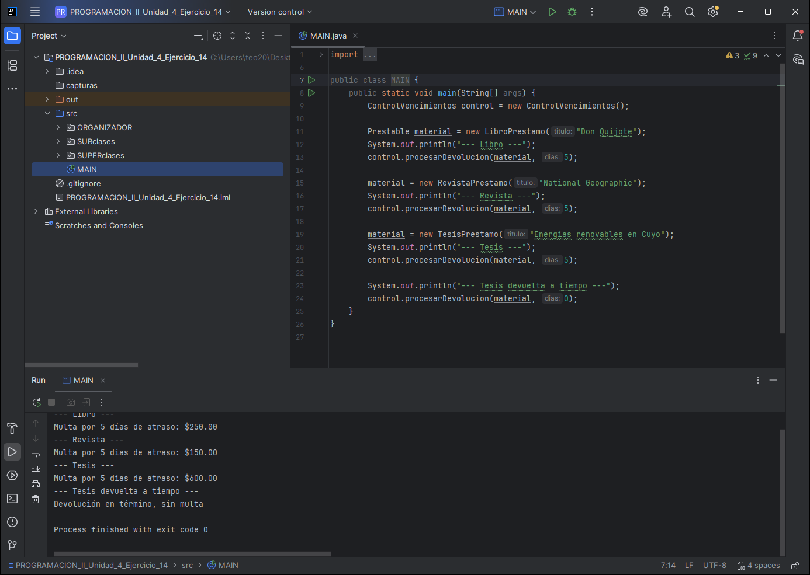

# PROGRAMACIÓN II — Unidad 4, Ejercicio 14: El Sistema de Gestión de Préstamos en Biblioteca

Trabajo práctico de Programación II. Este repositorio contiene la resolución en Java del ejercicio 14 de la Unidad 4.

## Consigna

#### Contexto

Una biblioteca digital administra el préstamo de diferentes recursos bibliográficos (libros físicos, revistas especializadas y tesis doctorales). Al momento de calcular las penalizaciones por demora en la devolución, el sistema aplica una regla general que se comporta de manera diferente según el tipo de material prestado.

#### Consigna

Modelar un sistema de gestión en Java donde el módulo de devoluciones interactúe polimórficamente con múltiples tipos de publicaciones para calcular recargos por retraso.

#### Desarrollo requerido

- Definir una interfaz Prestable que declare el método double calcularMultaDemora(int diasAtraso).
- Desarrollar clases concretas como LibroPrestamo, RevistaPrestamo y TesisPrestamo que implementen la interfaz anterior con tarifas de penalización diferenciadas por día.
- Crear una clase ControlVencimientos que contenga un método procesarDevolucion(Prestable material, int dias) capaz de aceptar cualquier recurso de forma polimórfica.
- En el método main, simular devoluciones cambiando dinámicamente el tipo de material evaluado y reflejar el costo de la multa calculada por consola.

## Estructura del repositorio

```
PROGRAMACION_II_Unidad_4_Ejercicio_14/
├── README.md
├── capturas/
│   └── consola.png
└── src/
    ├── ORGANIZADOR/
    │   └── ControlVencimientos.java
    ├── SUBclases/
    │   ├── LibroPrestamo.java
    │   ├── RevistaPrestamo.java
    │   └── TesisPrestamo.java
    ├── SUPERclases/
    │   └── Prestable.java
    └── MAIN.java   # clase con el método main
```

## Funcionamiento y lógica

El ejercicio aplica **polimorfismo con una interfaz** para calcular las multas por devolver tarde distintos materiales de una biblioteca. Está organizado en los paquetes `SUPERclases`, `SUBclases` y `ORGANIZADOR`.

### `SUPERclases.Prestable` (interfaz)

Define `double calcularMultaDemora(int diasAtraso)`.

### `SUBclases`

Cada material guarda su título y cobra un monto distinto por día de atraso. Si no hay atraso, la multa es 0.

- **`LibroPrestamo`:** $50 por día.
- **`RevistaPrestamo`:** $30 por día.
- **`TesisPrestamo`:** $120 por día.

### `ORGANIZADOR.ControlVencimientos`

Su método `procesarDevolucion(material, dias)` le pide la multa al material: si es 0, informa que se devolvió en término; si no, muestra el monto con dos decimales.

### `MAIN`

Usa una variable de tipo `Prestable` y procesa devoluciones con 5 días de atraso:

- Libro *Don Quijote* → **$250.00**.
- Revista *National Geographic* → **$150.00**.
- Tesis *Energías renovables en Cuyo* → **$600.00**.

Al final devuelve la tesis a tiempo (0 días): sale **sin multa**.

## Ejecución

Captura de la consola de IntelliJ IDEA ejecutando el programa:



Salida obtenida:

```
--- Libro ---
Multa por 5 días de atraso: $250.00
--- Revista ---
Multa por 5 días de atraso: $150.00
--- Tesis ---
Multa por 5 días de atraso: $600.00
--- Tesis devuelta a tiempo ---
Devolución en término, sin multa
```
